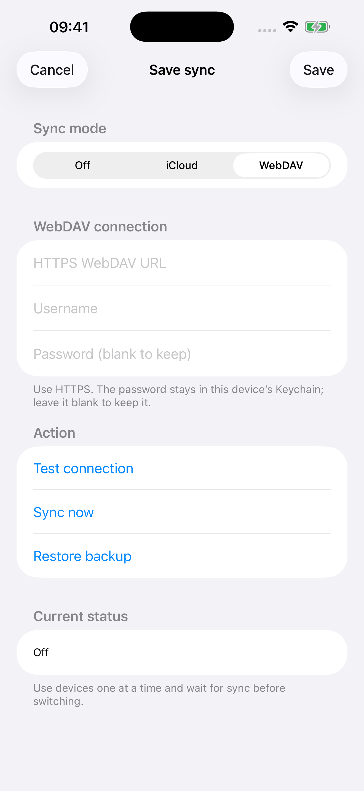

# WebDAV save sync with independent backups

中文：[SAVE_SYNC.zh-CN.md](SAVE_SYNC.zh-CN.md)

Apple builds offer mutually exclusive Off, iCloud and WebDAV modes. WebDAV works with a free signing account and does not need Synology Drive. This is a single-user protocol: use one device at a time and wait for transfers to finish before switching devices. There are no cross-client locks or ETag conditions. Android and HarmonyOS do not expose these settings.

## Setup

1. Install Synology WebDAV Server and enable HTTPS. Give a dedicated account read/write access to a dedicated directory. Other compatible WebDAV servers may work; the tests use a local server.
2. Create that directory and enter its final HTTPS URL. Reverse proxies must allow GET, PUT, MKCOL, PROPFIND, MOVE and DELETE, including the MOVE Destination and Overwrite headers. Use a trusted certificate.
3. On the iOS main menu or character-selection screen, tap the build caption to open Save sync. Select WebDAV and enter the URL, username and password. The password stays in this device's Keychain; the configuration JSON contains no password. Leave the password field empty to retain it. The Mac application menu also exposes these settings; Mac app behavior is not validated in this change.
4. Test connection, save, then fully quit and reopen the app. The connection test only uses a newly created temporary directory. It checks raw-file read/write, listings and MOVE replacement without LOCK/UNLOCK or strong ETags. iCloud mode still requires its signing entitlement.

The native settings below run in an isolated iOS Simulator harness with fake configuration and no game data or credentials. English is used as the fallback for new settings/errors in Spanish, Russian and Korean; transfer captions include translations in those languages.



## Messages and diagnostics

Automatic sync displays transfer progress in the build caption without opening error dialogs. Settings show a short actionable message; a restart notice is retained when remote saves cannot be loaded during play. Configuration and restore confirmations are shared between iOS and Mac.

Errors use nine categories: configuration, authentication, network, server operations, local files, invalid sync data, incompatible format, unavailable backup and Keychain. Diagnostics include fixed operation identifiers, numeric HTTP/system codes, group kinds, file/request counts and elapsed time; URLs, paths, credentials and request/save contents are not logged.

## Remote files and groups

The URL is used directly as the synchronization root.

```text
<configured directory>/
  save/                 Current raw game files, preserving relative paths
    Hero/Hero.d2s
    Hero/Hero.swpouch
    SharedStashSoftCoreV2.d2i
    ...
  backup/               One previous revision per group
  .d2r-sync.json         Format 4: group ownership, revisions, paths and times
```

Each character and its sidecars forms one group. Each shared stash and its `.swvault` forms another; softcore and hardcore are separate. Remaining files form an auxiliary group. `Settings` is excluded. Only changed groups upload and rotate their previous backup. Deleting a group keeps its previous revision for recovery. Characters and stashes may temporarily have different progress on the server while syncing.

Files in `save/` and `backup/` remain usable raw saves. With the game closed, edit `save/` directly and restart the app; no hash configuration changes are needed. Automatic checks use PROPFIND listings and actual modification times, reusing unchanged local content. New or modified files download, and deletions are applied. Startup does not download backup content; selecting a backup fetches that group.

If an editor preserves timestamps, or two edits share a server timestamp, use Sync now to read current content in full, then restart to load it. Files without usable timestamps download on every check. Remote metadata contains no file sizes or hashes; local fingerprints still detect local changes and identify cached content. Hand edits discovered on the NAS take priority over stale pending uploads.

## Saving, transactions and recovery

- Only successful filesystem commits trigger uploads. Under the filesystem lock, the hook clones the committed immutable snapshot; grouping, content comparison and networking happen outside that lock.
- Each changed group waits about 200 ms to coalesce adjacent commits. Leaving a game bypasses the normal 30-second foreground throttle. Each commit is queued independently, including a stash committed five seconds after its character.
- Transfers are serial. Pending versions of the same group coalesce; a new commit during an upload is retained for a subsequent transfer. Network/authentication failure stops that attempt, keeps the snapshot and backs automatic retries off by at least 30 seconds. Manual sync can retry immediately.
- A complete group is staged and its file paths checked before publication. PUT responses of 200, 201 or 204 are accepted without downloading the uploaded content for comparison, including JSON records. The connection test still checks reading its disposable file, and interrupted uploads may compare already staged files before resuming.
- Serial requests share one HTTP session; a timed-out session is discarded before further requests. Validated listings, staging markers and parent-directory observations are reused only within a sync attempt. Directory moves/deletes invalidate affected observations, and final current-file listings also populate the local cache.
- An exclusive character directory with nonempty current and next versions rotates as a whole: delete `backup/<character>/`, MOVE `save/<character>/` into backup, then MOVE the staged directory into `save/`. Before deletion, backup paths must match the registered group. First uploads, empty/deleted groups, flat character saves, stashes and auxiliary groups use per-file transactions.
- A recoverable journal persists each directory step or file-phase boundary before proceeding. Fresh publication reuses this attempt's completed checks; interrupted transactions recheck physical source/target paths, require an unambiguous state and reject unknown staged files. Other groups remain untouched. Startup recovers interrupted transactions before mounting saves. During publication, do not manually move staged/current/backup files.
- Startup waits up to eight seconds for sync and otherwise keeps local play available. iOS controls background execution time, so force-quitting cannot guarantee an upload has finished.
- Remote updates found while playing require restarting; mounted saves are not replaced. Other local groups can still upload. Ordinary conflicts use the group's save time; detected manual NAS edits take priority.
- The build caption shows Uploading character/stash, Downloading character/stash and a final Checking phase. A successful group shows Character/Stash synced for about two seconds, then the original build number. New transfers replace completion text immediately. The same area opens settings, outside gameplay.
- The restore picker lists group names and backup times. Restore applies only to that group on next launch, first backing up local saves. Publishing the restored group makes its former current revision the new previous backup.

There is no concurrency protection. Temporary `.d2r-upload/`, progress and transaction files can remain after interruption; subsequent sync resumes and cleans them up. Local directory backups before downloaded replacements also retain only the latest copy.

## Initial connection and local state

A preexisting raw `save/` without metadata can be imported directly, along with any raw files in `backup/`. Group metadata is initialized without reuploading those files. On first connection, remote groups win, local-only groups are preserved and uploaded, and local replacements are backed up first. Save metadata uses format 4. Transaction records use format 3 for file operations and format 4 with directory mode for whole-character operations. Use an App supporting directory transactions on every device sharing the directory: an incompatible client stops before changing an unfinished directory transaction. There is no save-format conversion.

Local files beside `save/`:

```text
save-sync.json                Configuration without password
SaveSync/<space identifier>/
  state.json                  Acknowledged group revisions
  candidate.json              Latest complete snapshot metadata
  group-candidates.json       Pending group revisions retained across retries
  groups-observed.json        Local observations of remote content
  group-owners.json           Ownership retained after primary-file deletion
  pending-<time>-<revision>/   Immutable pending snapshot
  objects/                    Local content cache
  current-files.json          Remote revision/timestamps and local cache index
  backups/                    Latest local pre-replacement backup
  restore.json                Pending restore, if any
```

## Verification

On a Mac with Xcode command-line tools, run the transport, lifecycle and gesture tests with disposable fake saves:

```bash
python3 -B -m unittest scripts.tests.test_nas_errors scripts.tests.test_nas_sync scripts.tests.test_nas_lifecycle scripts.tests.test_sync_build_touch
make -C dm/host/tests build/t_build_sync
./dm/host/tests/build/t_build_sync
python3 dm/i18n/scan_literals.py
python3 dm/ios/tools/dm_i18n.py --check
```

An optional live check requires explicitly passing a private JSON file with `url`, `username` and `password`. Keep it outside Git, readable only by you:

```bash
python3 -B scripts/test_live_nas.py --config /absolute/path/to/private-config.json
```

It creates and removes only a random `codex-probe-<UUID>` child directory with fake saves; credentials are never printed or passed on the command line. The grouped protocol tests use localhost, and no real NAS saves are accessed. See the PR for the exact builds/tests performed and outstanding device checks. No game program, RomFS, assets or real saves are included in this change.
