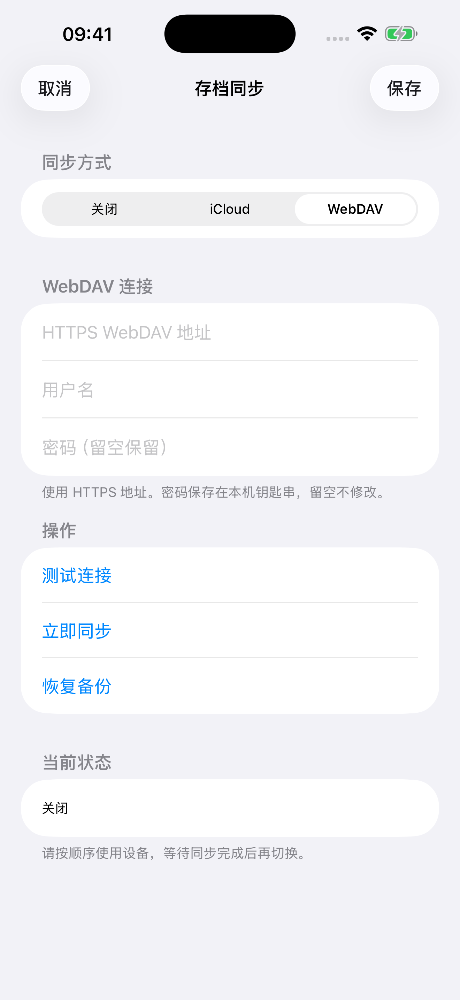

# WebDAV 存档同步与分组备份

English: [SAVE_SYNC.md](SAVE_SYNC.md)

Apple 版本提供互斥的「关闭 / iCloud / WebDAV」模式。WebDAV 可配合免费签名使用，不需要 Synology Drive。这是单人协议：同一时间只使用一个设备，传输结束后再换设备，没有跨客户端锁或 ETag 条件写入。Android 和鸿蒙不提供这些设置。

## 配置

1. 在群晖安装 WebDAV Server 并启用 HTTPS，给专用账号授予专用目录的读写权限。其他兼容 WebDAV 服务也可能可用；测试使用本机服务。
2. 提前创建目录，填写最终 HTTPS 地址。反向代理须允许 GET、PUT、MKCOL、PROPFIND、MOVE、DELETE，转发 MOVE 的 Destination、Overwrite 请求头，并使用可信证书。
3. 在 iOS 主菜单或选角页点击构建版本号，打开「存档同步」，选择 WebDAV 并填写地址、用户名和密码。密码保存在本机 Keychain，配置 JSON 不含密码；密码留空表示保留。Mac 应用菜单也提供设置入口，但本次没有验证 Mac 应用行为。
4. 测试连接、保存，再彻底退出并重开 App。测试仅操作新建临时目录，检查原始文件读写、目录列表及 MOVE 替换，不需要 LOCK/UNLOCK 或强 ETag。iCloud 仍需对应签名权限。

以下原生设置界面在独立 iOS 模拟器测试壳运行，使用假配置，没有游戏内容或凭据。新增设置和错误文字提供中英版本，西语、俄语、韩语暂用英文；传输状态已有这些语言的翻译。



## 提示与诊断

自动同步在构建版本文字位置显示进度，不弹出错误对话框；设置页仅显示简短、可处理的原因。游戏运行期间无法载入远端更新时提示重启。iOS 与 Mac 共用配置保存、备份恢复提示。

错误分为配置、认证、网络、服务器操作、本地文件、同步数据异常、格式不兼容、备份失效及钥匙串九类。诊断仅记录固定操作标识、HTTP／系统数值错误码、分组类型、文件数、请求数及耗时，不记录地址、路径、凭据或请求与存档内容。

## 远端文件与分组

直接使用填写的地址作为同步根目录。

```text
<填写的目录>/
  save/                 当前原始存档，保留相对路径
    Hero/Hero.d2s
    Hero/Hero.swpouch
    SharedStashSoftCoreV2.d2i
    ...
  backup/               各组上一版备份
  .d2r-sync.json         格式 4：分组归属、版本、路径及时间
```

每个角色及附属文件为一组，每个共享仓库及其 `.swvault` 为一组，软核与硬核分别处理；其余文件归辅助组，排除 `Settings`。仅变化的组上传并轮换上一版备份，删除分组也保留上一版以便恢复。同步期间 NAS 上角色与仓库可能暂时处于不同进度。

`save/` 与 `backup/` 保持可用的原始存档。关闭游戏后可直接编辑 `save/`，再重启载入，不需要修改 hash 配置。自动检查通过 PROPFIND 读取文件列表和实际修改时间，复用未变化的本机内容，下载新增或修改的文件，并处理删除。启动不下载备份内容，选择恢复时才下载对应组。

编辑器保留修改时间、或连续修改落在同一服务器时间精度内时，点击「立即同步」完整读取当前存档，再重启载入。服务器不提供有效修改时间的文件每次都下载。远端元数据没有大小或 hash 校验，本机仍使用内容指纹识别变化及缓存。发现 NAS 手工修改后，优先采用 NAS，避免旧待传版本覆盖。

## 保存、事务与恢复

- 只有成功提交才触发上传。文件系统锁内仅克隆已提交的不可变快照；分组、内容比较和联网在锁外完成。
- 每个变化组等待约 200 毫秒合并相邻提交。退局绕过普通前台 30 秒限流，各次提交独立排队，包括比角色晚 5 秒提交的仓库。
- 串行传输，未开始的同组版本合并；上传期间再次提交则保留新版本随后传输。网络或认证失败停止本轮请求，保留快照，自动重试至少间隔 30 秒；手动同步可立即重试。
- 先暂存完整分组并检查文件路径，再发布。PUT 返回 200、201 或 204 即视为上传成功，包括 JSON 记录，不再下载刚上传的内容进行比较。测试连接仍验证临时文件可读；中断上传续传时可能比较已有暂存文件。
- 串行请求共用 HTTP 会话；超时后丢弃会话，后续请求重新建连。已验证的目录列表、暂存标记和父目录观察仅在本轮同步中复用，目录移动或删除后对应观察失效；最终当前文件列表同时用于更新本机缓存。
- 独占角色目录的当前版和新版均非空时，按整目录轮换：删除 `backup/<角色>/`，将 `save/<角色>/` MOVE 到备份，再将暂存目录 MOVE 到 `save/`。删除前备份路径必须与已登记分组一致。首次上传、空组、删除角色、平铺角色、仓库及辅助组使用逐文件事务。
- 可恢复事务在每个目录步骤或逐文件阶段边界保存进度，确认后才继续。正常发布复用本轮刚完成的检查；中断恢复重新检查物理源、目标路径，要求状态明确并拒绝未知暂存文件，不影响其他组。启动挂载存档前恢复中断事务；发布过程中不要手工移动暂存、当前或备份文件。
- 启动最多等待同步 8 秒，离线仍可使用本机存档。iOS 决定后台时间，强杀前不能保证上传完成。
- 游戏运行期间发现 NAS 更新时要求重启，不替换已挂载存档；其他本地组仍可上传。普通冲突按分组保存时间选择，已检测到的 NAS 手工修改优先。
- 构建文字显示「角色上传中 / 仓库上传中」「角色下载中 / 仓库下载中」及最后「检查中」。单组成功后显示「角色已同步 / 仓库已同步」约 2 秒，再恢复构建号；新传输立即覆盖完成提示。游戏外点击同一位置打开设置。
- 恢复列表显示分组名称及备份时间，仅所选组下次启动恢复，先备份本机。发布恢复版本时，该组原当前版本成为新的上一版。

没有并发保护。中断后可能保留 `.d2r-upload/`、进度或事务文件，后续同步继续并清理。下载替换前的本地整目录备份也仅保留最新一份。

## 首次连接与本机状态

已有原始 `save/` 但无元数据时，可直接导入，并识别 `backup/` 中的原始备份，为各组建立元数据，无需重新上传这些文件。首次连接以远端已有组为准，本机独有组保留并上传，替换本机前先备份。存档元数据使用格式 4；逐文件事务使用格式 3，整角色目录事务使用格式 4 并标记目录模式。共用该目录的设备均应使用支持目录事务的 App；不兼容客户端发现未完成的目录事务会在修改数据前停止，不进行存档格式转换。

`save/` 旁的本地文件：

```text
save-sync.json                无密码的配置
SaveSync/<空间标识>/
  state.json                  已确认的分组版本
  candidate.json              最新完整快照信息
  group-candidates.json       跨重试保留的分组待传版本
  groups-observed.json        本机观察的远端内容
  group-owners.json           主文件删除后保留归属
  pending-<时间>-<版本>/      不可变待传快照
  objects/                    本机内容缓存
  current-files.json          远端版本、修改时间及本机缓存索引
  backups/                    最近一次本机替换前备份
  restore.json                待执行恢复（如有）
```

## 验证

在安装 Xcode 命令行工具的 Mac 上，使用临时假存档验证传输、生命周期及手势：

```bash
python3 -B -m unittest scripts.tests.test_nas_errors scripts.tests.test_nas_sync scripts.tests.test_nas_lifecycle scripts.tests.test_sync_build_touch
make -C dm/host/tests build/t_build_sync
./dm/host/tests/build/t_build_sync
python3 dm/i18n/scan_literals.py
python3 dm/ios/tools/dm_i18n.py --check
```

可选的线上实测必须显式传入含 `url`、`username`、`password` 的私密 JSON；文件放在 Git 外并限制为仅自己可读：

```bash
python3 -B scripts/test_live_nas.py --config /absolute/path/to/private-config.json
```

脚本只新建并清理随机 `codex-probe-<UUID>` 子目录中的假存档，不输出凭据或将其传入命令行。分组协议测试使用 localhost，不访问真实 NAS 存档。确切构建、测试及待验证设备流程见 PR。本次不含游戏程序、RomFS、美术或真实存档。
