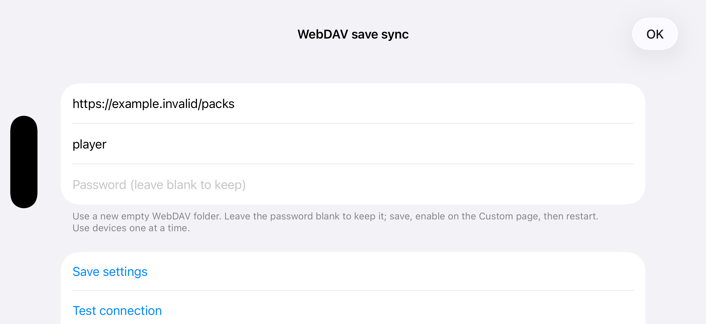

# WebDAV save-pack backend

中文：[WEBDAV_SYNC.zh-CN.md](WEBDAV_SYNC.zh-CN.md)

An optional storage backend for the existing iCloud sync core. Character packing, change decisions, deletion markers, pre-replacement backups, shared-stash safeguards and merging are shared; WebDAV requests replace container file operations. Each backend has a separate baseline and does not transfer data to the other automatically.

## Build and entry

Disabled by default; the ordinary Custom page and iCloud behavior remain unchanged. Generate both matching compilation settings and the interface overlay:

```bash
DM_IOS_WEBDAV=1 ./dm/ios/run.sh build
DM_MAC_WEBDAV=1 ./dm/tools/mac_app.sh
```

For free iOS signing, also set `DM_FREE_ACCOUNT=1`. Mac builds need neither `DM_MAC_ICLOUD=1` nor paid iCloud signing. Prepare your game files and build environment as upstream documents. The generated project can then be built in Xcode. Regenerate after changing the switch; do not combine a binary and overlay produced with different settings.

The game's **Options → Custom** page provides **WebDAV save sync** and **WebDAV settings**. WebDAV is off by default and mutually exclusive with iCloud. Apply, cancel and reset follow the existing page; restart after switching modes. A complete connection configuration is required before enabling. There is no build-number tap entry, additional Mac menu or routine transfer progress.

This is the actual settings UI in an isolated iOS Simulator shell, with dummy configuration and no game content or real credentials. The in-game Custom entry still requires gameplay validation and a product-review sample.



## Configuration and data

1. Create a new empty WebDAV directory and enter its HTTPS URL. The account needs listing, read, write, move and temporary-test cleanup permissions.
2. Enter URL, username and password, test the connection, and save. Passwords use the device Keychain; leaving the field blank keeps the stored password.
3. Enable WebDAV on the Custom page, apply, quit completely and restart. Use devices sequentially and allow the previous sync to finish before switching.

Remote storage contains `<character>.pack` per character and `_stash.pack` for all shared stashes, using the existing iCloud pack format. Local game saves remain ordinary files. Editing a `.d2s` directly inside a remote pack is not supported. There is no raw-file directory protocol, remote backup history or old-data migration.

In-game commits only replace the latest pending immutable snapshot. Uploads happen on leaving a run or entering background; Mac waits for a final attempt before quitting. Runtime sync only uploads; downloads and replacement happen before save mounting on the next launch. Failed units are not acknowledged. Network/authentication errors stop the attempt and retry at a later safe lifecycle event. Startup, deletion and force-quit rules follow iCloud, including possible recovery of a deletion that was never published.

First-sync same-name character conflicts prefer the remote copy, after backing up the local copy and recording a notice. Shared stashes reuse empty-save protection, Chronicle merging, the conflict inbox and the existing in-game item-merge flow. Backends do not operate simultaneously.

State and local backups are under `WebDAVPacks/<server-account identifier>/` next to `save`; configuration is `webdav-packs.json`. Other WebDAV implementations' configurations, caches and data are not read. Pending snapshots use the shared `.cloudsnap` lifecycle. Transfer rounds are temporary and cleaned at startup/completion; no permanent `objects/` cache exists.

## Verification, failures and backups

Upload to a temporary pack, verify its remote length, MOVE it into place and check the final file. Size must be available from HEAD or WebDAV properties and match. Downloads also compare the actual received byte count. Only complete publication advances the baseline.

Compare recognized server content hashes when available: standard `Repr-Digest`, `Content-Digest` on full downloads, and Nextcloud's server-computed upload `X-Hash` responses. SHA-512, SHA-256, SHA-1 and MD5 are supported. ETags, client-written checksums and digests of empty HEAD bodies are not treated as file hashes. Malformed or mismatching supported digests stop the attempt rather than downgrade it to success. Without a usable hash, verification is size-only and cannot detect every same-length corruption. Normal uploads have no complete GET readback.

Local backups follow the core's existing rules: retain the latest three protected versions per sync unit; backup failure prevents replacement/deletion. **Local backups** lists and exports the original files. Disable sync and close the game before restoring them through the existing file-import workflow. No one-click restore or NAS backup-rotation protocol is added.

This backend assumes one person using devices sequentially. LOCK and reliable conditional ETags are not required; the server must implement single-file MOVE reliably. Automatic failures are logged without additional alerts. Transport logs contain operation, code, byte count and verification mode, never credentials, request bodies or save contents. The shared core retains its existing diagnostics.

## Isolated tests

```bash
python3 -B -m unittest scripts.tests.test_webdav_backend scripts.tests.test_webdav_integration
make -C dm/host/tests build/t_cloudsync
./dm/host/tests/build/t_cloudsync
python3 dm/i18n/scan_literals.py
python3 dm/ios/tools/dm_i18n.py --check
```

The driver permits only a loopback HTTP fake service. App tests additionally require isolated `DM_APP_SUPPORT` (Mac) or `DM_SAVE_TEST` (iOS) and an explicit `DM_TEST_WEBDAV_URL=http://127.0.0.1:<port>/packs`. They use fixed dummy credentials, never real passwords or NAS saves. Production configuration always requires HTTPS.

Report builds, Simulator UI, real HTTP regression and gameplay separately. Simulator checks do not replace an iPhone's guest-thread stack or actual background-suspension checks.

[Validation results and remaining device checks](WEBDAV_SYNC_VALIDATION.md).
