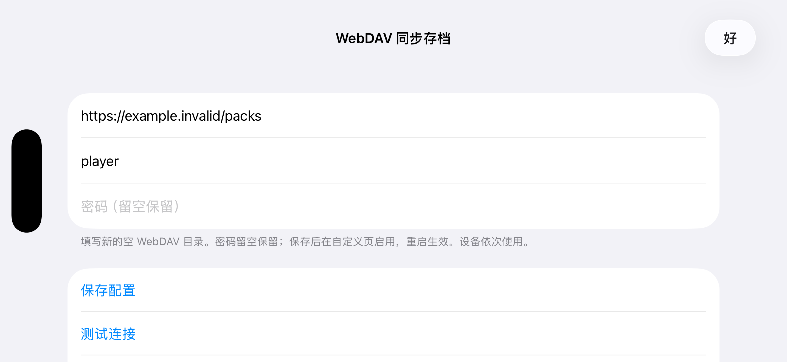

# WebDAV 存档包后端

English: [WEBDAV_SYNC.md](WEBDAV_SYNC.md)

这是现有 iCloud 同步核心的可选存储后端。两者共用角色打包、变化判断、删除标记、覆盖前备份、共享仓库保护及合并逻辑；iCloud 容器读写替换为 WebDAV 请求。两种后端各自保留同步基线，不会自动搬运彼此的数据。

## 构建与入口

默认不启用，普通包的自定义页和 iCloud 行为保持原样。启用时必须同时生成对应的编译配置与界面覆盖层：

```bash
DM_IOS_WEBDAV=1 ./dm/ios/run.sh build
DM_MAC_WEBDAV=1 ./dm/tools/mac_app.sh
```

iOS 免费签名构建可同时设置 `DM_FREE_ACCOUNT=1`；Mac 不需要 `DM_MAC_ICLOUD=1` 或付费 iCloud 签名。按上游要求准备游戏文件及构建环境。生成工程后可继续用 Xcode 编译；切换功能开关时重新运行构建准备流程，不能只替换二进制或沿用另一种开关的界面覆盖层。

游戏「选项 → 自定义」页提供「WebDAV 同步存档」和「WebDAV 设置」。WebDAV 默认关闭，与 iCloud 互斥；应用、取消及恢复默认沿用原页行为，模式切换重启生效。缺少完整连接配置时不能启用。无构建号点击入口或新增 Mac 菜单，也不显示常规传输进度。

下面是独立 iOS 模拟器壳中运行的真实设置界面，使用假配置，没有游戏内容或真实凭据。自定义页入口仍需在实际游戏流程中验证，并提交产品样张评审。



## 配置与数据

1. 创建新的空 WebDAV 目录，填写该目录的 HTTPS 地址。账号需要列举、读取、写入、移动及删除测试临时文件的权限。
2. 在设置界面填写地址、用户名及密码，测试连接后保存。密码保存在本机 Keychain，留空保留已有密码。
3. 返回自定义页启用 WebDAV，点应用，再彻底退出并重启。设备依次使用，切换设备前让上一次同步结束。

远端每个角色一个 `<角色名>.pack`，全部共享仓库合为 `_stash.pack`，使用原有 iCloud 的包格式。本机游戏存档仍是原始文件。不能直接在 NAS 上修改包内的 `.d2s`；本后端不提供原始文件目录协议、远端备份历史或旧数据迁移。

局内只记最新已提交快照，退局或切后台上传；Mac 退出时等待收尾。运行期间只上传，下载及本机替换在下次启动挂载前完成。失败不确认对应版本，网络和认证错误停止本轮请求，等待后续安全同步时机重试。启动、删除和强杀后的处理沿用 iCloud：例如尚未发布的删除在重启时可能被按缺档恢复。

首次同名角色冲突以远端为准，本机版本先备份并提示。共享仓库继续使用空档保护、编年史合并和冲突收件箱；物品合并也使用现有游戏内流程。两种后端不同时运行。

同步状态和本机备份位于 `save` 旁的 `WebDAVPacks/<服务器账号标识>/`，配置为 `webdav-packs.json`。不读取其他 WebDAV 实现的配置、缓存或数据。待传快照使用共用生命周期的 `.cloudsnap`，临时传输目录在系统临时目录下，启动及完成时清理；没有永久 `objects/` 缓存。

## 校验、失败与备份

上传先写临时包，检查远端大小后 MOVE 发布，再检查正式文件。大小必须可由 HEAD 或 WebDAV 属性取得并匹配；下载还检查实际字节数。只在全部确认后更新同步基线。

服务器提供可识别的内容摘要时同时比较 hash：标准 `Repr-Digest`、完整下载的 `Content-Digest`，以及 Nextcloud 计算上传内容的 `X-Hash` 响应。支持 SHA-512、SHA-256、SHA-1 和 MD5；不把 ETag、客户端自行写入的摘要或 HEAD 空正文摘要当成文件 hash。已提供的受支持摘要错误或不匹配时停止，不降级为成功。无可用 hash 时仅校验大小，不能保证发现同长度损坏。不对普通上传执行完整 GET 读回。

本机备份沿用核心规则，每个同步单位保留最近 3 份需要保护的版本；备份失败就不覆盖或删除。设置中的「本机备份」可列出并导出原始文件。恢复前关闭同步、退出游戏，再按原有文件导入方式操作；没有一键恢复或 NAS 备份轮换协议。

这是单人、设备依次使用的后端，不要求 LOCK 或可靠的 ETag 条件写入。服务器必须可靠执行单文件 MOVE。自动失败写日志，不增加弹窗；WebDAV 传输日志不包含凭据、请求正文或存档内容，保留操作、错误码、长度和校验方式。共用核心保留现有诊断日志。

## 隔离测试

```bash
python3 -B -m unittest scripts.tests.test_webdav_backend scripts.tests.test_webdav_integration
make -C dm/host/tests build/t_cloudsync
./dm/host/tests/build/t_cloudsync
python3 dm/i18n/scan_literals.py
python3 dm/ios/tools/dm_i18n.py --check
```

测试驱动只允许本机回环 HTTP 假服务。实际 App 的测试入口还必须指定隔离的 `DM_APP_SUPPORT`（Mac）或 `DM_SAVE_TEST`（iOS），并显式提供 `DM_TEST_WEBDAV_URL=http://127.0.0.1:<端口>/packs`；只使用固定假账号，不读取真实密码，不连接真实 NAS。正常配置始终要求 HTTPS。

构建、模拟器界面、真实 HTTP 回归和实际游戏流程分别记录验证结果；模拟器不能替代 iPhone 游戏线程小栈及真实后台挂起验证。

[验证结果及待完成的真机检查](WEBDAV_SYNC_VALIDATION.md)。
